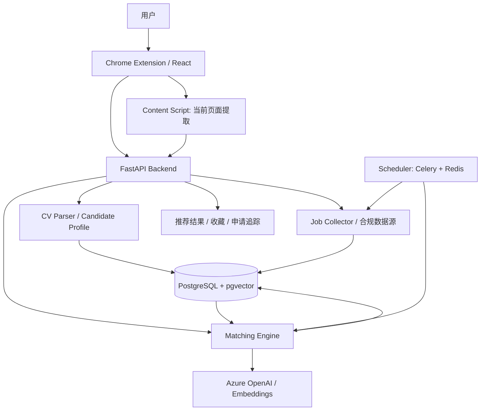

# JobPilot AI — 智能求职浏览器插件项目大纲

## 1. 项目概述

**项目名称：** JobPilot AI  
**项目类型：** Chrome Extension + AI Job Matching Agent + Cloud Backend  
**目标：** 根据用户简历和求职偏好，读取招聘页面、搜索合规职位数据源、分析岗位匹配程度，并提供可解释的职位推荐与申请追踪。

### 1.1 核心价值
- 降低手动浏览和筛选招聘信息的时间成本。
- 将非结构化 CV 与 Job Description（JD）转化为可分析的数据。
- 结合规则过滤、语义检索和 LLM 评估，提供有依据的匹配结果。
- 构建可展示 Agent、RAG/Embedding、浏览器扩展、云部署与 CI/CD 能力的端到端作品。

### 1.2 初期目标用户与场景
面向在新西兰寻找初级 AI、LLM 应用开发、Python 开发和 AI 自动化相关岗位的求职者。第一版重点支持用户打开一条招聘页面后，点击插件即可查看该岗位与其简历的匹配报告。

## 2. 功能范围

### 2.1 核心功能
1. **用户画像管理**：上传 PDF/DOCX 简历；提取教育、技能、认证、项目及工作经验；允许用户确认和修改解析结果。
2. **求职偏好配置**：目标岗位、地区、薪资、工作形式、级别、必要条件及排除条件。
3. **当前页面分析**：通过 Chrome Content Script 获取用户主动打开的招聘页面内容，识别并结构化 JD。
4. **职位采集**：后续通过官方 API、获准数据源及符合网站条款的自动化方式搜索职位。
5. **智能匹配**：硬性条件过滤、Embedding 语义召回、LLM 解释性评估。
6. **推荐与追踪**：匹配分数、匹配证据、技能差距、收藏、去重、申请状态及原始职位链接。
7. **定时报告**：在后端运行允许范围内的周期性搜索，并推送新增高匹配职位。

### 2.2 非目标（初期不实现）
- 绕过 CAPTCHA、反爬措施或访问限制。
- 未经用户确认自动投递、发送消息或修改外部招聘账户。
- 依赖浏览器插件在浏览器关闭后持续执行后台任务。
- 对签证资格或录用概率作确定性判断。

## 3. 技术架构



### 3.1 技术选型
| 层级 | 技术 | 职责 |
|---|---|---|
| 浏览器插件 | Chrome Manifest V3、TypeScript、React、Vite | 设置、当前页面提取、结果展示 |
| 后端 API | Python、FastAPI、Pydantic | 数据验证、业务逻辑、任务接口 |
| AI | Azure OpenAI、Embedding、结构化输出 | CV/JD 解析、语义匹配、评估解释 |
| 数据库 | PostgreSQL + pgvector | 用户画像、职位、向量、匹配记录 |
| 自动化与任务 | Playwright（仅合规场景）、Celery、Redis | 采集适配器、后台调度 |
| 部署与安全 | Azure Container Apps / App Service、Key Vault | 服务托管、密钥管理 |
| 质量与观测 | Pytest、Playwright Tests、GitHub Actions、Application Insights / OpenTelemetry | 测试、CI/CD、监控 |

## 4. 数据模型

### 4.1 Candidate Profile
- `education`：学历与专业
- `skills`：技术技能及熟练度（可由用户确认）
- `certifications`：认证
- `work_experience`：岗位、职责、时间
- `projects`：项目、技术栈、成果
- `preferences`：求职偏好（与客观履历分开存储）

### 4.2 Job Schema 示例
```json
{
  "job_id": "source-123456",
  "title": "Junior AI Engineer",
  "company": "Example Ltd",
  "location": "Auckland",
  "source": "Example Job Board",
  "employment_type": "Full-time",
  "description": "...",
  "required_skills": ["Python", "Azure", "REST API", "LLM"],
  "experience_level": "Junior",
  "job_url": "https://example.com/job/123456",
  "posted_date": "2026-10-18"
}
```

建议另建 `users`、`candidate_profiles`、`job_preferences`、`jobs`、`job_embeddings`、`match_results`、`saved_jobs`、`application_tracking`、`collection_runs` 表。职位唯一键优先采用平台 ID 与来源组合，并增加 URL/内容指纹辅助去重。

## 5. 核心工作流

### 5.1 单岗位分析（MVP）
1. 用户上传简历并核对解析结果。
2. 用户打开招聘岗位详情页，主动点击插件的“分析岗位”。
3. Content Script 提取可见 JD，清洗后发送给 FastAPI。
4. 后端将 JD 转为结构化数据，执行硬性条件检查。
5. Matching Engine 结合简历、偏好和 JD 生成评分、原文证据与技能差距。
6. 插件展示报告，允许用户收藏并反馈结果是否准确。

### 5.2 批量搜索与推荐（后续版本）
1. 用户设置搜索范围及调度频率。
2. Job Collector 从允许的数据源采集职位，规范化并去重。
3. 硬性条件过滤不适合的岗位。
4. Embedding 进行语义召回，筛选候选集。
5. LLM 仅对候选集进行详细评估，控制 Token 成本。
6. 存储结果、排序并生成新增职位报告。

### 5.3 Agent Tools（后续版本）
- `search_jobs()`：搜索合规职位数据源。
- `extract_job_details()`：结构化 JD。
- `get_candidate_profile()`：读取用户授权的履历信息。
- `match_job()`：执行匹配与解释。
- `save_job()`：保存或更新职位。
- `generate_report()`：汇总推荐结果。

**设计原则：** 搜索、去重、过滤和存储优先使用确定性 Workflow；LLM 负责文本理解、必要的工具选择和解释，不授予无限制的浏览器或外部账户操作权限。

## 6. 匹配算法

### 6.1 三级匹配
1. **Hard Filtering**：地区、工作形式、明确必要资格、级别等条件；未知信息应标记为待确认，不直接视为不符合。
2. **Semantic Matching**：将 Candidate Profile 与 JD 向量化，进行语义召回。
3. **LLM Evaluation**：对召回职位做细粒度分析，返回分数、依据、技能差距与不确定项。

### 6.2 初始评分模型

\[
Score = 0.35S + 0.25E + 0.20R + 0.20P
\]

| 维度 | 权重 |
|---|---:|
| S：技能匹配 | 35% |
| E：经验匹配 | 25% |
| R：岗位职责语义匹配 | 20% |
| P：求职偏好匹配 | 20% |

各维度标准化至 0–100；权重为初始假设，需用人工标注样本和用户反馈校准。匹配分数不是录用概率。LLM 输出采用 Pydantic/JSON Schema 验证，重要判断附 JD/CV 证据，禁止虚构经验。

## 7. 前端页面规划

- **Popup Dashboard**：当前页面分析入口、简历状态、最新推荐摘要。
- **Profile & Preferences**：简历上传、解析结果编辑、求职偏好。
- **Match Detail**：总分、维度分、匹配证据、技能差距、待确认条件。
- **Recommended Jobs**：筛选、排序、查看原始链接、收藏。
- **Application Tracker**：未申请、准备中、已申请、面试、Offer、已结束。
- **Settings**：数据源授权、定时频率、通知、隐私与删除数据。

## 8. API 初步设计

| Method | Endpoint | 作用 |
|---|---|---|
| POST | `/api/profile/resume` | 上传并解析简历 |
| GET/PATCH | `/api/profile` | 获取/更新画像 |
| GET/PATCH | `/api/preferences` | 获取/更新偏好 |
| POST | `/api/jobs/analyze` | 分析当前岗位 |
| GET | `/api/jobs` | 查询已收集职位 |
| POST | `/api/search-runs` | 创建搜索任务 |
| GET | `/api/matches` | 获取推荐结果 |
| POST | `/api/jobs/{id}/save` | 收藏职位 |
| PATCH | `/api/applications/{id}` | 更新申请状态 |

API 需要身份认证、输入校验、限流和用户数据隔离。

## 9. 安全、隐私与合规

- CV、求职偏好和申请记录作为个人数据处理；传输加密、访问控制、最小化保存并支持删除。
- API 密钥仅放后端/Key Vault，不嵌入浏览器插件。
- 插件权限最小化，优先通过用户点击触发页面读取；清晰说明所读取的页面数据。
- 对每个招聘平台核实条款、API 授权和自动化边界；不绕过 CAPTCHA 或限制。
- 将招聘网页内容视为不可信输入，防止 Prompt Injection；工具调用采用白名单及参数校验。
- 外部写操作（尤其申请、发送消息）必须经用户明确确认。
- 日志不记录完整简历、凭据及不必要的敏感信息。

## 10. 开发里程碑

| 阶段 | 预计周期 | 主要交付物 | 验收标准 |
|---|---|---|---|
| Phase 1：MVP | 1–2 周 | 插件、CV 解析、当前页面 JD 分析 | 打开测试岗位页后可生成有依据的匹配报告 |
| Phase 2：Search Engine | 1–2 周 | 合规数据源接入、职位数据库、去重、向量召回 | 可检索、过滤并排序批量职位 |
| Phase 3：Agent & Tracking | 1–2 周 | 工具编排、定时任务、收藏与申请追踪 | 能生成新增岗位报告并记录用户反馈 |
| Phase 4：Cloud & CI/CD | 约 1 周 | Azure 部署、测试、GitHub Actions、监控 | 自动测试和部署通过，关键请求可追踪 |

时间为单人开发的粗略估计，不含第三方平台授权等待。

## 11. 测试与评估

- **单元测试**：CV/JD 解析、字段验证、评分计算、去重与过滤。
- **集成测试**：插件 → API → 数据库 → 模型的完整链路。
- **端到端测试**：使用自建模拟招聘页面，避免依赖第三方网站结构稳定性。
- **AI 评估集**：建立人工标注的 CV–JD 样本，评估推荐排序、理由准确性、虚构信息率。
- **非功能指标**：分析延迟、失败率、Token 成本、任务成功率、数据删除验证。

## 12. 交付成果

- Chrome Extension 源码与可安装开发包。
- FastAPI 服务及数据库迁移脚本。
- 架构图、数据模型、API 文档和 README。
- 测试用例、示例数据和评估报告。
- GitHub Actions CI/CD 配置及 Azure 部署说明。
- 产品 Demo：简历上传 → 当前职位分析 → 推荐解释 → 收藏/追踪。

## 13. 建议的第一步

先完成 **“单个招聘页面 + 一份 CV → AI 匹配报告”** 的闭环。暂不接入复杂的跨站自动搜索，先验证解析准确性、评分可解释性、插件与后端通信，再逐步扩展数据源和 Agent 功能。
