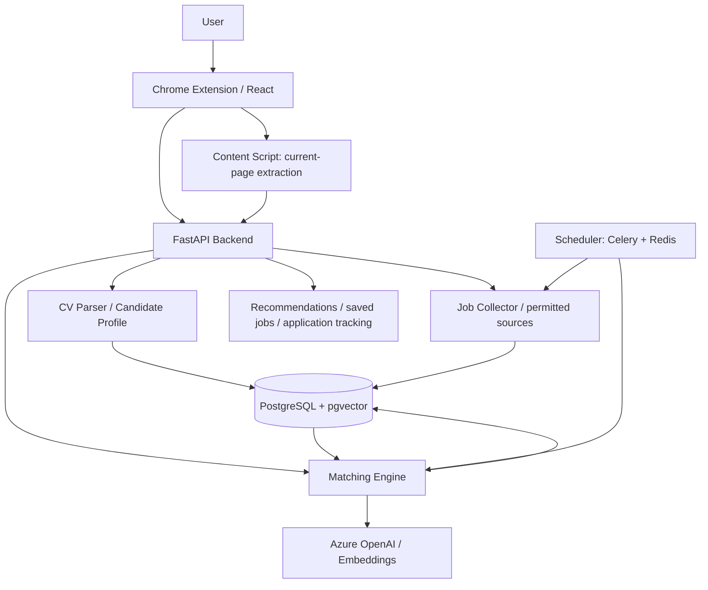

# JobPilot AI — Project Outline for an AI Job-Search Browser Extension

## 1. Overview

**Project name:** JobPilot AI  
**Project type:** Chrome Extension + AI Job Matching Agent + Cloud Backend  
**Goal:** Based on the user's resume and job preferences, read job pages, search permitted job data sources, analyse how well each role matches, and provide explainable job recommendations and application tracking.

### 1.1 Core value
- Cut the time spent manually browsing and filtering job listings.
- Turn unstructured CVs and Job Descriptions (JDs) into data that can be analysed.
- Combine rule-based filtering, semantic retrieval and LLM evaluation to give evidence-backed match results.
- Build an end-to-end portfolio project that demonstrates agents, RAG/embeddings, browser extensions, cloud deployment and CI/CD.

### 1.2 Initial target users and scenario
Job seekers in New Zealand looking for junior AI, LLM-application development, Python development and AI-automation roles. The first version focuses on one flow: the user opens a job posting, clicks the extension, and sees a match report comparing that role with their resume.

## 2. Scope

### 2.1 Core features
1. **Candidate profile management**: upload a PDF/DOCX resume; extract education, skills, certifications, projects and work experience; let the user review and edit the parsed result.
2. **Job preference settings**: target roles, locations, salary, work arrangement, seniority, must-haves and deal-breakers.
3. **Current-page analysis**: use a Chrome content script to read the job page the user has opened themselves, then identify and structure the JD.
4. **Job collection**: later, search for jobs through official APIs, permitted data sources and automation that complies with each site's terms.
5. **Smart matching**: hard-requirement filtering, embedding-based semantic recall, explanatory LLM evaluation.
6. **Recommendations and tracking**: match score, match evidence, skill gaps, saved jobs, de-duplication, application status and the original job link.
7. **Scheduled reports**: run periodic searches on the backend within permitted limits and push newly found high-match jobs.

### 2.2 Non-goals (not in early versions)
- Bypassing CAPTCHAs, anti-scraping measures or access restrictions.
- Automatically applying, sending messages or changing external job-site accounts without the user's confirmation.
- Relying on the browser extension to keep running background tasks after the browser is closed.
- Making definitive judgements about visa eligibility or the chance of getting an offer.

## 3. Architecture



### 3.1 Technology choices
| Layer | Technology | Responsibility |
|---|---|---|
| Browser extension | Chrome Manifest V3, TypeScript, React, Vite | Settings, current-page extraction, displaying results |
| Backend API | Python, FastAPI, Pydantic | Data validation, business logic, task endpoints |
| AI | Azure OpenAI, embeddings, structured output | CV/JD parsing, semantic matching, explanations |
| Database | PostgreSQL + pgvector | Candidate profiles, jobs, vectors, match records |
| Automation and tasks | Playwright (compliant use only), Celery, Redis | Collection adapters, background scheduling |
| Deployment and security | Azure Container Apps / App Service, Key Vault | Hosting, secret management |
| Quality and observability | Pytest, Playwright Tests, GitHub Actions, Application Insights / OpenTelemetry | Testing, CI/CD, monitoring |

## 4. Data model

### 4.1 Candidate Profile
- `education`: degrees and majors
- `skills`: technical skills and proficiency (user can confirm)
- `certifications`: certifications
- `work_experience`: role, responsibilities, dates
- `projects`: projects, tech stack, outcomes
- `preferences`: job preferences (stored separately from the factual work history)

### 4.2 Example Job Schema
```json
{
  "job_id": "source-123456",
  "title": "Junior AI Engineer",
  "company": "Example Ltd",
  "location": "Auckland",
  "source": "Example Job Board",
  "employment_type": "Full-time",
  "description": "...",
  "required_skills": ["Python", "Azure", "REST API", "LLM"],
  "experience_level": "Junior",
  "job_url": "https://example.com/job/123456",
  "posted_date": "2026-10-18"
}
```

Suggested tables: `users`, `candidate_profiles`, `job_preferences`, `jobs`, `job_embeddings`, `match_results`, `saved_jobs`, `application_tracking`, `collection_runs`. The unique key for a job should preferably be the platform ID combined with the source, with a URL/content fingerprint as a secondary de-duplication signal.

## 5. Core workflows

### 5.1 Single-job analysis (MVP)
1. The user uploads a resume and reviews the parsed result.
2. The user opens a job detail page and clicks "Analyze job" in the extension.
3. The content script extracts the visible JD, cleans it and sends it to FastAPI.
4. The backend turns the JD into structured data and runs the hard-requirement checks.
5. The Matching Engine combines the resume, preferences and JD to produce scores, verbatim evidence and skill gaps.
6. The extension shows the report and lets the user save it and give feedback on whether it is accurate.

### 5.2 Batch search and recommendations (later versions)
1. The user sets the search scope and schedule.
2. The Job Collector gathers jobs from permitted sources, normalises them and removes duplicates.
3. Hard-requirement filtering removes unsuitable roles.
4. Embeddings do semantic recall to pick a candidate set.
5. The LLM evaluates only the candidate set in detail, to keep token costs under control.
6. Results are stored, ranked and turned into a report of new jobs.

### 5.3 Agent tools (later versions)
- `search_jobs()`: search permitted job data sources.
- `extract_job_details()`: structure a JD.
- `get_candidate_profile()`: read the work history the user has authorised.
- `match_job()`: run matching and explanation.
- `save_job()`: save or update a job.
- `generate_report()`: summarise recommendations.

**Design principle:** searching, de-duplication, filtering and storage use deterministic workflows wherever possible. The LLM handles text understanding, necessary tool selection and explanations, and is never given unrestricted control over the browser or external accounts.

## 6. Matching algorithm

### 6.1 Three-stage matching
1. **Hard filtering**: location, work arrangement, explicitly required qualifications, seniority and similar conditions. Unknown information is marked as needing review, not treated as a mismatch.
2. **Semantic matching**: embed the Candidate Profile and the JD and do semantic recall.
3. **LLM evaluation**: analyse recalled jobs in detail and return scores, reasoning, skill gaps and open questions.

### 6.2 Initial scoring model

\[
Score = 0.35S + 0.25E + 0.30R + 0.10P
\]

| Dimension | Weight |
|---|---:|
| S: skills match | 35% |
| E: experience match | 25% |
| R: semantic match of responsibilities | 30% |
| P: job-preference match | 10% |

Each dimension is normalised to 0–100. The weights are initial assumptions (changed on 2026-10-21 from R 20% / P 20% to R 30% / P 10%) and need calibrating with hand-labelled samples and user feedback. The match score is not a probability of getting an offer. LLM output is validated with Pydantic/JSON Schema, important judgements carry JD/CV evidence, and inventing experience is forbidden.

## 7. Planned front-end pages

- **Popup Dashboard**: entry point for analysing the current page, resume status, summary of the latest recommendations.
- **Profile & Preferences**: resume upload, editing the parsed result, job preferences.
- **Match Detail**: overall score, dimension scores, match evidence, skill gaps, conditions to confirm.
- **Recommended Jobs**: filter, sort, open the original link, save.
- **Application Tracker**: not applied, preparing, applied, interviewing, offer, closed.
- **Settings**: data-source authorisation, schedule frequency, notifications, privacy and data deletion.

## 8. Initial API design

| Method | Endpoint | Purpose |
|---|---|---|
| POST | `/api/profile/resume` | Upload and parse a resume |
| GET/PATCH | `/api/profile` | Get/update the profile |
| GET/PATCH | `/api/preferences` | Get/update preferences |
| POST | `/api/jobs/analyze` | Analyse the current job |
| GET | `/api/jobs` | Query collected jobs |
| POST | `/api/search-runs` | Create a search run |
| GET | `/api/matches` | Get recommendations |
| POST | `/api/jobs/{id}/save` | Save a job |
| PATCH | `/api/applications/{id}` | Update application status |

The API needs authentication, input validation, rate limiting and per-user data isolation.

## 9. Security, privacy and compliance

- Treat CVs, job preferences and application records as personal data: encrypt in transit, control access, store only what is needed and support deletion.
- Keep API keys on the backend / in Key Vault; never embed them in the browser extension.
- Keep extension permissions minimal, prefer reading pages only when the user clicks, and state clearly what page data is read.
- For every job platform, check the terms, API authorisation and limits on automation; never bypass CAPTCHAs or restrictions.
- Treat job-page content as untrusted input to prevent prompt injection; tool calls use an allowlist and argument validation.
- External write actions (especially applying or sending messages) require the user's explicit confirmation.
- Logs never contain full resumes, credentials or unnecessary sensitive information.

## 10. Milestones

| Phase | Estimated duration | Main deliverables | Acceptance criteria |
|---|---|---|---|
| Phase 1: MVP | 1–2 weeks | Extension, CV parsing, JD analysis of the current page | Opening a test job page produces an evidence-backed match report |
| Phase 2: Search Engine | 1–2 weeks | Permitted data sources, job database, de-duplication, vector recall | Batches of jobs can be searched, filtered and ranked |
| Phase 3: Agent & Tracking | 1–2 weeks | Tool orchestration, scheduled tasks, saved jobs and application tracking | Can produce a report of new jobs and record user feedback |
| Phase 4: Cloud & CI/CD | About 1 week | Azure deployment, tests, GitHub Actions, monitoring | Automated tests and deployment pass; key requests are traceable |

Durations are rough estimates for a single developer and do not include waiting for third-party platform authorisation.

## 11. Testing and evaluation

- **Unit tests**: CV/JD parsing, field validation, score calculation, de-duplication and filtering.
- **Integration tests**: the full chain from extension → API → database → model.
- **End-to-end tests**: use self-built mock job pages so tests don't depend on third-party sites keeping their structure.
- **AI evaluation set**: build hand-labelled CV–JD samples to evaluate ranking, accuracy of the reasoning and the rate of invented information.
- **Non-functional metrics**: analysis latency, failure rate, token cost, task success rate, verification of data deletion.

## 12. Deliverables

- Chrome extension source and an installable development build.
- FastAPI service and database migration scripts.
- Architecture diagram, data model, API documentation and README.
- Test cases, sample data and an evaluation report.
- GitHub Actions CI/CD configuration and Azure deployment instructions.
- Product demo: resume upload → current-job analysis → explained recommendation → save/track.

## 13. Suggested first step

First complete the loop **"one job page + one CV → AI match report"**. Hold off on complex cross-site automated search; first validate parsing accuracy, the explainability of the scores and the communication between extension and backend, then expand data sources and agent features step by step.
