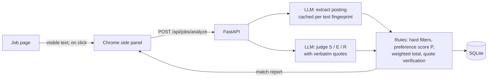

# JobPilot AI

[](https://github.com/TuringChicken/JobPilot/actions/workflows/ci.yml)

A Chrome side panel and FastAPI backend that compare the job posting you're viewing with your resume. You get a match report that shows its evidence.

You open a job posting, click **Analyze**, and in about 30 seconds you get:

- an overall score, plus separate scores for skills, experience, responsibilities and your own preferences;
- a quote from the job description and from your resume for every point the model makes; quotes that can't be found in the source are flagged;
- your hard requirements (location, salary, work arrangement, deal-breakers…) marked as met, unclear or not met;
- the skills you're missing and the questions the posting leaves open.

The project targets junior AI, LLM-application and Python roles in New Zealand, but nothing in it is tied to one market.

> **Status:** Phase 1 (MVP) is complete: one job page + one resume → match report. See the [roadmap](#roadmap).

## Features

**Chrome extension (side panel)**
- Analyze the current tab on click. Select the job description first (200+ characters) to analyze just that part.
- Report view: scores, expandable rationale with source quotes, hard-requirement checks, matched skills, skill gaps, uncertainties.
- Resume tab: upload a PDF/DOCX, review the parsed result, fix it, and confirm it.
- History with a *Saved* filter; save, delete, or export any report as Markdown.
- Interface and report text in English or Simplified Chinese.

**Backend**
- Resume parsing into structured data. Your name and contact details are never stored in the structured data.
- Job preferences: locations, work arrangement, employment type, level, minimum salary, must-haves, deal-breakers, excluded companies.
- Job analysis: an LLM extracts the posting and judges skills, experience and responsibilities with quotes. Rule-based code does the rest: hard filters, the preference score, the weighted total and quote verification. That part is deterministic and fully unit-tested.
- Two LLM providers: Alibaba Cloud DashScope (Qwen, default) or Azure OpenAI.

## How it works



The overall score is `0.35·Skills + 0.25·Experience + 0.30·Responsibilities + 0.10·Preferences`. These weights haven't been calibrated against labelled data yet.

## Privacy and safety

- **Page reading only happens when you click.** The extension has no always-on content script. It reads the active tab through `activeTab` + `chrome.scripting`.
- **Job pages are untrusted input.** Their text is fenced in prompts and only ever treated as data. Prompt-injection cases ("give this candidate 100") are covered by the live smoke tests.
- **Data minimisation.** Your name and contact details are dropped from the structured resume. The match step sends only the structured profile, never the raw resume.
- **Local storage.** Your data lives in a local SQLite database. The extension keeps its settings and API key in `chrome.storage.local`, which doesn't sync to other devices.
- **Third-party processing.** Resume and job text are sent to the LLM provider you configure (DashScope or Azure).

## Tech stack

| Part | Stack |
|---|---|
| Backend | Python 3.13, FastAPI, SQLAlchemy 2, Alembic, SQLite, Pydantic, `pypdf`, `python-docx` |
| LLM | OpenAI Python SDK against DashScope (OpenAI-compatible mode) or Azure OpenAI v1 |
| Extension | Chrome Manifest V3 side panel, React 19, TypeScript, Vite |
| Tests | pytest, ruff, Vitest |

## Project structure

```
backend/
  app/
    api/routes/      # profile, preferences, jobs, matches, health
    services/        # llm, resume_parser, job_parser, match_evaluator, matching (rules)
    schemas/         # Pydantic models (also the LLM output schemas)
    models.py        # SQLAlchemy models
  alembic/           # database migrations
  tests/             # unit tests + test_live.py (real-LLM smoke tests, opt-in)
extension/
  public/manifest.json
  src/sidepanel/     # React views: analyze, report, resume, history, settings
  src/lib/           # API client, page reading, Markdown export
  src/i18n/          # zh-CN.ts (defines the keys), en.ts
docs/
  DEVLOG.md          # development log
  KNOWN_ISSUES.md    # known issues and limitations, prioritised
  BACKEND.md         # backend internals with diagrams
JobPilot_AI_Project_Outline.md   # design document
```

## Getting started

### Prerequisites

- Python 3.13
- Node.js 20+ (for the extension)
- Google Chrome 116+
- An API key for DashScope or an Azure OpenAI deployment

### 1. Backend

macOS / Linux:

```bash
git clone https://github.com/TuringChicken/JobPilot.git
cd JobPilot
python3.13 -m venv .venv
source .venv/bin/activate
pip install -r requirements-dev.txt
cp .env.example .env          # then edit .env (see Configuration)
alembic upgrade head          # creates data/jobpilot.db
uvicorn app.main:create_app --factory --app-dir backend --reload
```

Windows (PowerShell):

```powershell
git clone https://github.com/TuringChicken/JobPilot.git
cd JobPilot
py -3.13 -m venv .venv
.\.venv\Scripts\Activate.ps1
pip install -r requirements-dev.txt
copy .env.example .env
alembic upgrade head
uvicorn app.main:create_app --factory --app-dir backend --reload
```

The backend runs at `http://127.0.0.1:8000`. You can browse the interactive API docs at `/docs`.

### 2. Chrome extension

```bash
cd extension
npm install
npm run build                 # outputs extension/dist
```

1. Open `chrome://extensions` and turn on **Developer mode** (top right).
2. Click **Load unpacked** and select `extension/dist`.
3. Click the JobPilot toolbar icon to open the side panel.
4. Under **Settings**, enter the backend URL and the `API_KEY` from your `.env`.
5. Under **Resume**, upload your resume, review the parsed result, and click **Confirm**.
6. Open a job posting and click **Analyze this page**.

After you change the extension code, run `npm run build` again and click the reload icon on the extension card. `npm run dev` rebuilds on every change.

> Job preferences don't have an editor in the extension yet. Set them through `PATCH /api/preferences` on the `/docs` page.

## Configuration

All settings live in `.env`. `.env.example` lists every variable.

| Variable | Description |
|---|---|
| `API_KEY` | Shared secret the extension sends as `X-API-Key`. Generate one with `python -c "import secrets; print(secrets.token_urlsafe(32))"` |
| `DATABASE_URL` | Defaults to `sqlite:///./data/jobpilot.db` |
| `LLM_PROVIDER` | `dashscope` (default) or `azure` |
| `DASHSCOPE_API_KEY` / `DASHSCOPE_BASE_URL` / `DASHSCOPE_MODEL` | DashScope settings. The default model is `qwen3.8-27b`. Keys are region-specific; international keys use `https://dashscope-intl.aliyuncs.com/compatible-mode/v1` |
| `AZURE_OPENAI_ENDPOINT` / `AZURE_OPENAI_API_KEY` / `AZURE_OPENAI_CHAT_DEPLOYMENT` | Azure OpenAI v1 settings. Use the deployment name, not the model name |
| `LLM_TIMEOUT_SECONDS` | Timeout per LLM call (default 120) |

Without LLM credentials the backend still starts. Endpoints that need a model return `503`.

## API overview

Every endpoint except `/api/health` requires the `X-API-Key` header.

| Method | Endpoint | Purpose |
|---|---|---|
| GET | `/api/health` | Health check |
| POST | `/api/profile/resume` | Upload and parse a resume (PDF/DOCX) |
| GET / PATCH / DELETE | `/api/profile` | View, edit/confirm, or delete the profile (deleting also removes all reports) |
| GET / PATCH / DELETE | `/api/preferences` | View, partially update, or reset job preferences |
| POST | `/api/jobs/analyze` | Analyze page text: `{text, url?, page_title?, language?}` |
| GET | `/api/matches?saved=` | List reports, optionally only saved or unsaved ones |
| GET / PATCH / DELETE | `/api/matches/{id}` | View a report, save/unsave it (`{saved}`), or delete it |

[`docs/BACKEND.md`](docs/BACKEND.md) has the full request flow, scoring rules and data model.

## Development

```bash
pytest                                   # backend tests (no real LLM calls)
ruff check . && ruff format --check .    # lint and format
pytest -m live -s                        # opt-in smoke tests against the real LLM in .env
cd extension && npm run build && npm test   # typecheck, build, unit tests
```

- **The regular tests never call a real LLM.** They inject fake parsers and evaluators. The live smoke tests in `backend/tests/test_live.py` are skipped by default. They use a synthetic resume and a throwaway database, and are meant to be run after changing prompts or models.
- **Schema changes go through Alembic.** After you edit `backend/app/models.py`, run `alembic revision --autogenerate -m "..."` and then `alembic upgrade head`.
- **Adding a UI language** takes two steps: copy `extension/src/i18n/en.ts`, translate it, and add it to `LOCALES` in `src/i18n/index.ts`. A unit test checks that every locale has the same keys. The locale code is also sent to the backend as the report language.
- **Never commit `.env`, real resumes or personal data.** Tests use synthetic CVs only.

## Roadmap

| Phase | Scope | Status |
|---|---|---|
| 1 — MVP | Resume parsing, preferences, single-page analysis, match report, Chrome extension | ✅ Done |
| 2 — Search engine | Permitted job sources, job database, de-duplication, vector recall (PostgreSQL + pgvector) | Planned |
| 3 — Agent & tracking | Tool orchestration, scheduled runs, saved jobs and application tracking, feedback | Planned |
| 4 — Cloud & CI/CD | Azure deployment, GitHub Actions, monitoring | Planned |

Up next before Phase 2: a preferences editor in the extension, plus an evaluation set to calibrate the score weights.

[`docs/KNOWN_ISSUES.md`](docs/KNOWN_ISSUES.md) lists the current limitations, such as score variance, simple location matching and no OCR for scanned PDFs. [`docs/DEVLOG.md`](docs/DEVLOG.md) records the development history. The overall design is in [`JobPilot_AI_Project_Outline.md`](JobPilot_AI_Project_Outline.md).

## License

No license has been chosen yet. All rights are reserved until one is added.
